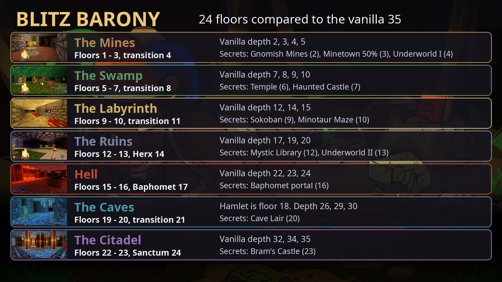
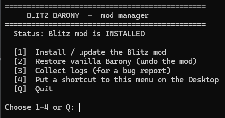
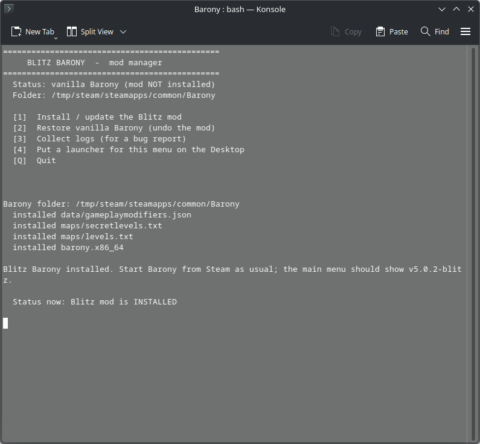
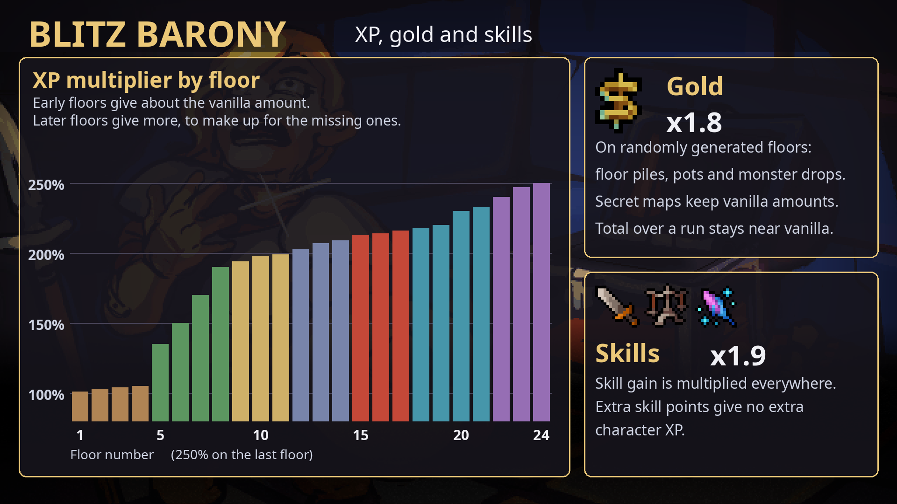
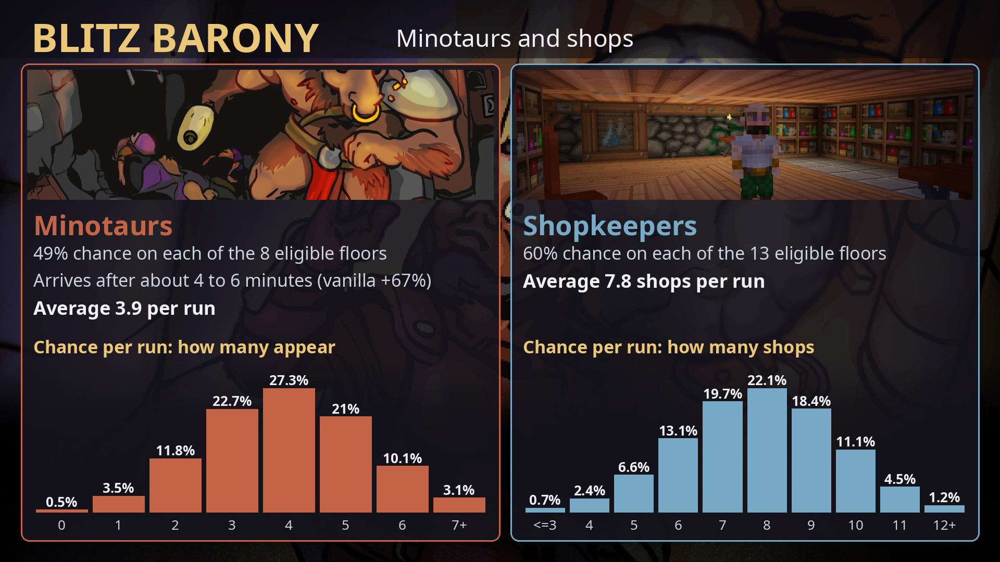

# Blitz Barony

<p align="center">
  
</p>

A shorter [Barony](https://store.steampowered.com/app/371970/Barony/) (v5.0.2).

**Why this mod exists:** a complete Barony run can easily swallow 8 hours. You scour the early floors for every last gold pile, then coast through the rest of the game flattening everything in your way, eventually turning into a dash to the exit on each remaining floor. If that sounds familiar, this mod can save you a lot of potentially wasted time. Does not disable Steam achievements.

It shortens the game by cutting out floors and tweaking XP and gold (plus a few smaller tweaks), so the balance stays just like vanilla. The details are listed at the [bottom of this page](#detailed-changes).

What changes:

- **Number of floors:** fewer floors per biome. Monsters and loot on each floor still match the vanilla depth that floor stands in for.
- **Secrets:** every secret level is kept, with its entrance moved to fit the shorter layout.
- **Minotaurs:** the chance of one appearing and the time before it arrives are adjusted.
- **Shops:** the chance of a shop appearing is adjusted.
- **XP:** scaled up with depth to make up for the missing floors.
- **Gold:** scaled up on the randomly generated floors.
- **Skills:** skill gain is scaled up.
- **Stations (optional rebalance tweak):** a cooking pot and a workbench can appear in more places, see [Stations](#stations).
- **Adaptive XP (optional rebalance tweak):** XP is boosted when you fall behind and reduced when you level far ahead, so grinding does not pay off, see [Adaptive XP](#adaptive-xp).
- **Settings file:** every number above can be changed in one plain text file, see [Settings](#settings).
- **Achievements:** stay enabled.

The stations and adaptive XP are optional extras on top of the shortened game: pick the install option you like (see [Install options](#install-options)) or switch either one off in the [settings file](#settings) at any time.

> This is an unofficial mod and is not affiliated with Turning Wheel. You need your own copy of Barony from Steam. No game assets are included.

## Install

The installer is a small menu that backs up every file it replaces, installs the mod, and can put vanilla back at any time. Your vanilla saves and your Blitz saves are kept apart.

### Windows (Steam)

1. In Steam, right-click Barony, choose **Manage**, then **Browse local files**. This opens the game folder (the one with `barony.exe`).
2. Download `Blitz-Barony-Windows-<version>.zip` from the [**Releases**](../../releases/latest) page and extract it **into that folder**. Allow overwriting if asked. You get a `BLITZ BARONY.bat` and a `blitz-mod` folder next to `barony.exe`.
3. Close Barony and double-click **`BLITZ BARONY.bat`**. Press **1** to install everything (or **2**, **3**, **4** to leave out the stations and/or adaptive XP, see [Install options](#install-options)).
4. Start Barony from Steam. The main menu should show **v5.0.2-blitz**.

The menu also has **5** (restore vanilla), **6** (collect logs for a bug report) and **7** (put a shortcut with the Barony icon on your Desktop).

<p align="center">
  <br>
  <em>The Windows menu (screenshot from an earlier version: the options are now numbered 1-7, see below).</em>
</p>


### Linux (Steam)

<p align="center">
  <br>
  <em>The menu after pressing 1.</em>
</p>

Works for the native Linux Barony and for the Windows Barony under Proton.

1. In Steam: Barony > Manage > **Browse local files**.
2. Download `Blitz-Barony-Linux-<version>.zip` (or `.tar.gz`) from the [**Releases**](../../releases/latest) page and extract it into that folder:
   `unzip -o Blitz-Barony-Linux-<version>.zip -d <that folder>` (or `tar xzf Blitz-Barony-Linux-<version>.tar.gz -C <that folder>`)
3. Close Barony. In a terminal, `cd` into the game folder and run:
   `bash "BLITZ BARONY.sh"`
   (Double-clicking it does nothing in some file managers, such as KDE Dolphin.)
4. Press **1** to install everything (see [Install options](#install-options) for the others), then start Barony from Steam. The main menu should show **v5.0.2-blitz**.


### Install options

| Menu | What you get |
|---|---|
| **1** All | Blitz + rebalanced stations + adaptive XP |
| **2** Blitz only | the shortened game, XP and gold, with no adaptive XP and the original station rules |
| **3** Blitz + rebalanced stations | no adaptive XP |
| **4** Blitz + adaptive XP | the original station rules |

You can run the menu again at any time to switch. Switching only changes the adaptive XP and station lines of your settings file and keeps your other edits.

### Going back to vanilla

Open the same menu and press **5**. Every original file is put back, the mod's files are removed, and your vanilla saves return. Steam's "Verify integrity of game files" also restores vanilla. You can install again afterwards.

## Multiplayer

- Everyone in a game needs the **same install**. The game version is `v5.0.2-blitz`, so vanilla clients cannot join a Blitz lobby, and the other way round.
- Steam lobbies work. Hosting an online lobby has been tested on Windows 11 and on Linux (Proton).
- Steam achievements keep working while the mod is installed (cheats still disable them, as in vanilla).
- Saves from vanilla do not carry over. Start a new game.

## Settings

All numbers are in `data/blitz.cfg` in the Barony folder: one setting per line with a comment saying what it does.

```
station_transition_percent = 50   # chance of a cooking pot in the chest room of each transition floor
adaptive_xp = 1                   # 1 = on, 0 = off
```

Save it and enter a new floor; no restart needed. The full list is in [BLITZ_CONFIG.md](BLITZ_CONFIG.md).

## Reporting a problem

Use menu option **6** (Collect logs) right after the problem, before starting Barony again, and send the file it creates. See [TESTING.md](TESTING.md) for a short test checklist and a report template.

## Common mistakes

- *"I subscribed to the Workshop item, why is nothing different?"* Subscribing only downloads the files. Run the installer (see Install above).
- *Only the host installed it.* Every player needs the same install.
- *Barony updated and the mod stopped working.* Press **5** (restore vanilla), then **1** (install) again, or verify the game files in Steam.

## Known issues

- The `/jumplevel` cheat command does not work. Use `/gotolevel <floor>` instead (after `/enablecheats`), for example `/gotolevel 5`.

## Credits and license

Inspired by https://steamcommunity.com/sharedfiles/filedetails/?id=3104488752 and the Blitz mode for Slay the Spire 2

Barony is made by Turning Wheel, and its source code is released under the BSD 2-Clause license. This mod is a modified build of that source. The overview images use screenshots and artwork from Barony and the [BaronyGame wiki](https://baronygame.fandom.com/), which belong to Turning Wheel. Barony's game files, art and sound are **not** included in the mod itself; the installer only adds the modified executable, a few libraries it needs, and three small data files.

---

## Detailed changes

### Floors

The run has 24 floors after the start map. "Vanilla depth" is the depth of the vanilla floor whose difficulty each Blitz floor uses: monsters, loot and item levels are generated as if you were that deep.

| Biome | Blitz floors | Number of floors | Vanilla depth |
|---|---|---|---|
| Start | 0 | 1 | 0 |
| The Mines | 1 - 3 | 3 | 2, 3, 4 |
| Mines to Swamp transition | 4 | 1 | 5 |
| The Swamp | 5 - 7 | 3 | 7, 8, 9 |
| Swamp to Labyrinth transition | 8 | 1 | 10 |
| The Labyrinth | 9 - 10 | 2 | 12, 14 |
| Labyrinth to Ruins transition | 11 | 1 | 15 |
| The Ruins | 12 - 13 | 2 | 17, 19 |
| Herx (boss) | 14 | 1 | 20 |
| Hell | 15 - 16 | 2 | 22, 23 |
| Baphomet (boss) | 17 | 1 | 24 |
| Hamlet | 18 | 1 | 25 |
| The Caves | 19 - 20 | 2 | 26, 29 |
| Caves to Citadel transition | 21 | 1 | 30 |
| The Citadel | 22 - 23 | 2 | 32, 34 |
| Sanctum (final) | 24 | 1 | 35 |

The three orbs are on the last floor of the Swamp (green, floor 7), the Labyrinth (red, floor 10) and the Ruins (blue, floor 13).

### Secret levels

All secrets are kept. The "entry floor" is the floor that contains the way in.

| Secret | Entry floor | Chance |
|---|---|---|
| Gnomish Mines | 2 (Mines) | 100% |
| Minetown | 3 (Mines) | 50% |
| Underworld, first pair of sections | 4 (Mines to Swamp transition) | 100% |
| Temple | 6 (Swamp) | 100% |
| Haunted Castle | 7 (Swamp) | 100% |
| Sokoban | 9 (Labyrinth) | 100% |
| Minotaur Maze | 10 (Labyrinth) | 100% |
| Mystic Library | 12 (Ruins) | 100% |
| Underworld, second pair of sections | 13 (Ruins) | 100% |
| Baphomet portal (leads to the Baphomet fight) | 16 (Hell) | 100% |
| Cave Lair | 20 (Caves) | 100% |
| Bram's Castle | 23 (Citadel) | 100% |

Floors 1, 5, 19 and 22 (the first floor of the Mines, Swamp, Caves and Citadel) have no secret. Leaving the first Underworld returns you to the Swamp; the exits of the second Underworld lead on to Herx or to Hell.

### Experience, skills and gold

<p align="center">
  
</p>

- **Experience** is multiplied by a value that grows with depth, so early floors give about the vanilla amount and later floors give more to make up for the floors that are gone. The curve is interpolated linearly between these points:

  | Vanilla depth | 1 | 5 | 8 | 10 | 26 | 35 |
  |---|---|---|---|---|---|---|
  | XP multiplier | 100% | 105% | 150% | 190% | 220% | 250% |

  Per Blitz floor that works out to:

  | Floor | 1 | 2 | 3 | 4 | 5 | 6 | 7 | 8 | 9 | 10 | 11 | 12 |
  |---|---|---|---|---|---|---|---|---|---|---|---|---|
  | XP | 101% | 103% | 104% | 105% | 135% | 150% | 170% | 190% | 194% | 198% | 199% | 203% |

  | Floor | 13 | 14 | 15 | 16 | 17 | 18 | 19 | 20 | 21 | 22 | 23 | 24 |
  |---|---|---|---|---|---|---|---|---|---|---|---|---|
  | XP | 207% | 209% | 213% | 214% | 216% | 218% | 220% | 230% | 233% | 240% | 247% | 250% |

- **Skill gain** is multiplied by 190% everywhere.
- **Gold** is multiplied by 180% on the randomly generated floors (floor piles, pots and monster drops). The fixed secret maps keep their vanilla amounts. By design the total over a run is close to the vanilla main route.
- Monster levels, loot and item generation use the vanilla depth column above, not the floor number.
- Dark floors keep the vanilla 25% chance, but the first floor of each biome is never dark.
- Hunger and regeneration are per-time mechanics and were left alone.

### Stations

*Optional rebalance tweak: leave it out with install option 2 or 4, or set the station chances to 0 in the settings file.*

Cooking pots (cauldrons) and workbenches work as in vanilla. The mod changes where they appear so that every part of the run has a chance at both:

| Where | What | Chance |
|---|---|---|
| The 4 transition floors (4, 8, 11, 21) | cooking pot in the small chest room | 50% each |
| The last generated floor of each biome (3, 7, 10, 13, 16, 20, 23) | workbench in the arrival room | 50% each |
| Each biome | one extra random pot or workbench on a normal floor | 33% per biome |
| The Hamlet (18) | cooking pot in the food shop and workbench in the weapon shop | always |
| The Underworld sections | one cooking pot per pair, as before | unchanged |

Transitions get no workbench because you have no scrap there yet. The roll is made from the map seed, so every player in a multiplayer game sees the same stations, and re-entering the same floor in the same game gives the same result.

### Adaptive XP

*Optional rebalance tweak: leave it out with install option 2 or 3, or set `adaptive_xp = 0` in the settings file.*

A second XP multiplier, worked out per player on every kill, is applied on top of the depth curve. It compares your level with the level a typical player has at that depth:

| Vanilla depth | 2 | 7 | 10 | 14 | 20 | 26 | 30 | 35 |
|---|---|---|---|---|---|---|---|---|
| Target level | 3 | 12 | 18 | 24 | 34 | 43 | 50 | 60 |

The target comes from the average of the daily leaderboard winners (level about 62 at the end) and from test runs. The multiplier is:

- **on target:** x1.0
- **15 or more levels behind:** x2.0 (a straight line in between)
- **15 or more levels ahead:** x0.4, never lower (a straight line in between)

Example at vanilla depth 12 (target 21): level 1 gets x2.0, level 21 gets x1.0, level 36 or more gets x0.4. In tests a character at level 1 dropped onto the Labyrinth reached about level 18 by the end of that floor killing monsters one at a time, while a level 67 character gained a single level on a whole later floor. All numbers are in the settings file, and `adaptive_xp = 0` turns it off.

### Shops

<p align="center">
  
</p>

Shops can appear on 13 eligible floors. Each eligible floor rolls **60%** independently. Hell never has a shop.

| Biome | Eligible floors | Expected shops |
|---|---|---|
| The Mines | 2, 3 | 1.2 |
| The Swamp | 5, 6, 7 | 1.8 |
| The Labyrinth | 9, 10 | 1.2 |
| The Ruins | 12, 13 | 1.2 |
| Hell | none | 0 |
| The Caves | 19, 20 | 1.2 |
| The Citadel | 22, 23 | 1.2 |
| **Whole run** | 13 floors | **7.8** |

Number of shops in a full run (calculated from the 60% rolls):

| Shops | 3 or fewer | 4 | 5 | 6 | 7 | 8 | 9 | 10 | 11 | 12 or more |
|---|---|---|---|---|---|---|---|---|---|---|
| Chance | 0.7% | 2.4% | 6.6% | 13.1% | 19.7% | 22.1% | 18.4% | 11.1% | 4.5% | 1.2% |

Two test runs (26 eligible floors in total) produced 16 shops, which is 61.5% and matches the setting.

### Minotaurs

Minotaurs can arrive on 8 eligible floors, never on the first floor of a biome. Each eligible floor rolls **49%** independently. The time before a minotaur shows up is also about 67% longer than in vanilla (5/3 of the vanilla timer). The last section of the first Underworld keeps its minotaur rule as in vanilla.

| Biome | Eligible floors | Expected minotaurs |
|---|---|---|
| The Mines | 2, 3 | 0.98 |
| The Swamp | 6, 7 | 0.98 |
| The Labyrinth | 10 | 0.49 |
| The Ruins | 13 | 0.49 |
| Hell | none | 0 |
| The Caves | 20 | 0.49 |
| The Citadel | 23 | 0.49 |
| **Whole run** | 8 floors | **3.9** |

Number of minotaur floors in a full run (calculated from the 49% rolls):

| Minotaurs | 0 | 1 | 2 | 3 | 4 | 5 | 6 | 7 or more |
|---|---|---|---|---|---|---|---|---|
| Chance | 0.5% | 3.5% | 11.8% | 22.7% | 27.3% | 21.0% | 10.1% | 3.1% |

### Other

- The version string is `v5.0.2-blitz`. Internally the multiplayer join packet carries a short `v5.0.2b` marker, because the packet only has room for 8 characters.
- The cheat console works after `/enablecheats`. `/gotolevel <n>` jumps to a floor from 1 to 24; `/jumplevel` does not work (see Known issues).
- The installer touches only these files: `barony.exe` (or `barony.x86_64`), four runtime DLLs on Windows, `maps/levels.txt`, `maps/secretlevels.txt`, `data/gameplaymodifiers.json` and `data/blitz.cfg`. Originals are copied to `_blitz_backup` in the game folder first.
